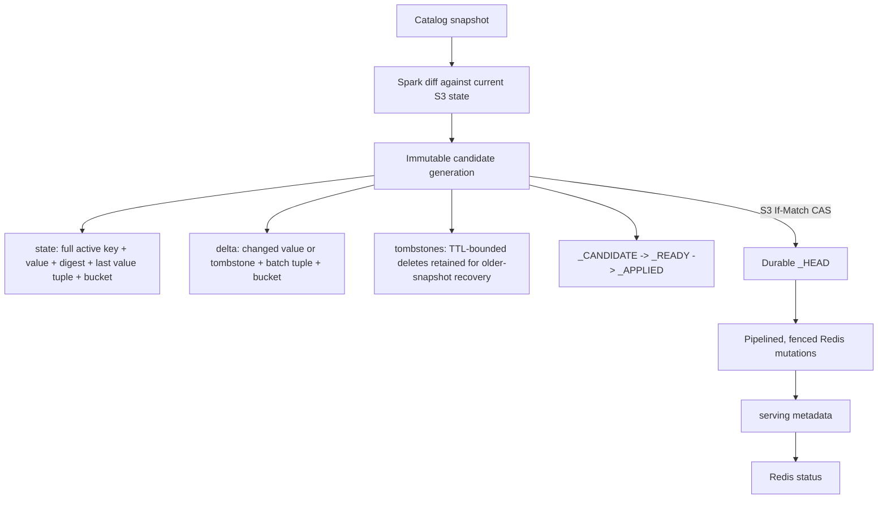

# Redis and Valkey KVStore

This module provides Chronon's Redis Cluster KVStore and its incremental Spark batch upload path. The Redis module is
bundled into `cloud_aws`; no extra KVStore JAR or factory implementation setting is required.

## AWS Selection

DynamoDB remains the AWS default. Select Redis in team/common configuration with:

```text
kv.store.type=redis
```

`KV_STORE_TYPE=redis` is also accepted in each runtime. API-driven `upload-to-kv` and fetcher commands accept
`-Zkv.store.type=redis`; `group-by-upload` itself selects from team/common configuration or its driver environment. A
Redis GroupBy upload selects the normal catalog-backed upload table directly instead of DynamoDB's Ion import files.
The Redis publisher disables Spark speculation in the session it creates; if it is given an existing Spark context
with speculation enabled, it fails rather than running duplicate mutation attempts.

`spark.chronon.table_write.format` selects the deployment's normal catalog format. The AWS scaffold selects Iceberg as
that format, and Iceberg supports the binary `key_bytes` and `value_bytes` columns used by Redis. The scaffold does not
configure Glue or another catalog; the deployment must supply the Spark catalog configuration used by its upload table.

The job role can authorize S3 and catalog access. Redis authentication is separate and uses the connection settings
below. The client supports private/unauthenticated Redis or static ACL username/password with optional TLS; it does not
generate or refresh AWS IAM authentication tokens.

## Configuration

Connection settings retain their existing environment aliases for secrets and runtime deployment configuration.

| Environment variable | Configuration key | Default |
| --- | --- | --- |
| `REDIS_CLUSTER_NODES` | `redis.cluster.nodes` | required |
| `REDIS_USERNAME` | `redis.username` | unset |
| `REDIS_PASSWORD` | `redis.password` | unset |
| `REDIS_USE_SSL` | `redis.ssl` | `false` |
| `REDIS_KEY_PREFIX` | `redis.key.prefix` | `chronon` |
| `REDIS_MAX_CONNECTIONS` | `redis.max.connections` | `50` |
| `REDIS_MIN_IDLE_CONNECTIONS` | `redis.min.idle.connections` | `5` |
| `REDIS_MAX_IDLE_CONNECTIONS` | `redis.max.idle.connections` | `10` |
| `REDIS_CONNECTION_TIMEOUT_MS` | `redis.connection.timeout.ms` | `5000` |
| `REDIS_SO_TIMEOUT_MS` | `redis.so.timeout.ms` | `2000` |
| `REDIS_MAX_REDIRECTIONS` | `redis.max.redirections` | `5` |

Environment variables take precedence over submitted properties. Prefer environment variables for credentials. Bulk
writers use a small internal pool and do not validate a connection on every borrow/return.

There are distinct configuration paths:

- A planner-backed scheduled publication has `group-by-upload` followed by `upload-to-kv`. The first step reads
  `kv.store.type` from the compiled GroupBy's team/common configuration (or `KV_STORE_TYPE` in its driver environment).
  The existing KV upload node runner merges its effective common plus `upload-to-kv` mode configuration into the
  online API properties, so one common `kv.store.type=redis` plus `redis.*` client configuration reaches both steps
  without extra submitter plumbing.
- The legacy `Driver` `upload-to-kv` path has no planner node metadata. Give it selector/client settings through
  `KV_STORE_TYPE`/`REDIS_*` or `-Z`; `CHRONON_ONLINE_ARGS` is included for this mode and can carry those `-Z` values.
  CLI `-Z` properties take precedence over node common values when the node runner is used.
- The `spark.chronon.kv_upload.redis.*` operator settings may come from team common/mode Spark configuration or `-Z`.
  Team common values are already folded into compiled mode configurations, and the Redis publisher reads the effective
  Spark configuration together with its API properties.
- The fetcher is a separate runtime and does not inherit Spark submission configuration. Configure it with
  `KV_STORE_TYPE=redis` plus `REDIS_*` environment variables, or pass `-Zkv.store.type=redis` and the corresponding
  `-Zredis.*` properties to `FetcherMain`.

Batch upload settings can be supplied through team common or `upload-to-kv` mode configuration, as Spark properties,
or as matching `-Z` properties. The node runner resolves them in that order, with `-Z` taking precedence.

| Property | Default | Meaning |
| --- | ---: | --- |
| `spark.chronon.kv_upload.redis.state_root` | required | Durable S3 root for Redis publication state |
| `spark.chronon.kv_upload.redis.batch_size` | `1000` | Redis commands grouped into each pipelined write |
| `spark.chronon.kv_upload.redis.max_keys_per_second` | `2500000` | Cluster-wide attempted key-command ceiling |
| `spark.chronon.kv_upload.redis.writer_partitions` | `2` | Concurrent Spark writer partitions |
| `spark.chronon.kv_upload.redis.state_buckets` | `256` | S3 state/delta buckets chosen for a new lineage |
| `spark.chronon.kv_upload.redis.max_retries` | `3` | Retries after a failed Redis command batch |
| `spark.chronon.kv_upload.redis.retry_backoff_ms` | `1000` | Initial exponential retry backoff, including maxmemory OOM retries |
| `spark.chronon.kv_upload.redis.ttl_seconds` | `432000` | Renewable value, tombstone, metadata, and status lease |
| `spark.chronon.kv_upload.redis.require_noeviction` | `true` | Require Redis `maxmemory-policy=noeviction` before writing |

A state root is the durable identity of one Redis serving target and must not be shared across Redis clusters. A dataset
lineage must keep the same key prefix. The first admitted generation fixes `state_buckets` for that lineage. A TTL change
publishes a new generation; a refresh of an existing generation uses the TTL recorded with that generation. TTL may
increase but cannot decrease inside an active lineage because delete fences must cover every prior value lease.
Concurrent jobs sharing a cluster must use the same rate while the shared queue is active.

## Publication Protocol

Each source partition is a complete snapshot with at least one entity row, unique `key_bytes`, non-null `value_bytes`,
and exactly one `GroupByServingInfo` row. The loader checks these invariants before admitting a generation.



The S3 layout is:

```text
<state_root>/<source_table>/<batch_dataset>/
  _HEAD
  claims/<uuid>
  generations/<uuid>/
    _CANDIDATE
    state/redis_bucket=<n>/part-*.parquet
    delta/redis_bucket=<n>/part-*.parquet
    tombstones/redis_bucket=<n>/part-*.parquet
    _READY
    _APPLIED
```

`_HEAD` is the durable publication pointer. It contains a monotonic revision, the admitted generation, its parent, and
the `_READY` digest. AWS updates it with an S3 ETag conditional write. A generation may be the head before `_APPLIED`
exists; the next invocation completes that immutable generation before admitting another one. Losing Redis status does
not lose the durable pointer or recovery values.

The first publication must use a fresh Redis key prefix or an otherwise empty serving namespace. With no prior S3
state, the loader cannot discover and tombstone unknown legacy keys that are absent from the source snapshot.

`_CANDIDATE`, `_READY`, `_APPLIED`, `_HEAD`, and `claims/<uuid>` are binary protocol records. Candidate claims fence
cleanup against active admission; an expired unclaimed candidate is marked abandoned before deletion, so a late writer
must rebuild under a new UUID.

Cleanup re-reads `_HEAD` before deletion. It keeps the current generation and any state generation it references, gives
the previous head a reader grace period, and removes expired failed or losing candidates. On a versioned S3 bucket,
configure lifecycle expiry for noncurrent versions under the state root because deleting obsolete generation paths
otherwise leaves noncurrent object versions billable.

Cleanup runs after successful uploads and deliberately keeps the current durable snapshot. To decommission a dataset,
stop its upload schedule, wait at least its Redis TTL plus recovery margin, verify that no reader or upload still uses the
lineage, then remove its `<state_root>/<source_table>/<batch_dataset>` subtree. Redis key expiry does not remove that S3
subtree.

## Ordering and Recovery

Every Redis value and tombstone carries `(source timestamp, write epoch)`. Timestamp is compared first, so an older
partition cannot overwrite a later partition. Equal timestamps use the S3 lineage epoch, making corrected same-partition
uploads deterministic. Older jobs repair and renew the current head instead of moving it backward.

Unchanged values are not blindly expired. A Lua command reads and checks only the ordering header before renewing the
TTL, avoiding a full payload read and hash for tiered values. Missing or older values trigger a full replay from the
immutable value-bearing S3 state. Retained tombstones remove keys resurrected by an older Redis snapshot. A newer value
is only accepted as supersession when S3 proves that a strictly newer head exists.

Serving metadata is written after entity mutations. The Redis status mirror is written only after mutation validation,
and `_APPLIED` is written last. Managed fetchers require status, hide tombstones, and treat a value whose tuple is ahead
of the published status as unavailable. This prevents a half-written generation from being decoded with metadata that
has not been published yet.

Direct writes to stable entity keys do not provide an atomic whole-GroupBy cutover. During an upload, different keys can
temporarily reflect different applied generations. Retries are idempotent, interrupted generations are resumed, and S3
admission retry is iterative and bounded rather than recursive.

## Redis Value Format

The first eight timestamp bytes preserve compatibility with the original Redis batch encoding. The incremental path
adds 14 bytes for its magic/version, operation, and write epoch. TTL is Redis key metadata, not part of the stored value.

```text
Redis value bytes
+-------------------+----------------+---------+-----------+-------------+
| source timestamp  | magic/version  | op code | S3 epoch  | user value  |
| 8 bytes           | CRB2 / v1      | 1 byte  | 8 bytes   | payload     |
+-------------------+----------------+---------+-----------+-------------+

UPSERT: payload is the encoded Chronon value
DELETE: payload is empty and the value is a tombstone
```

## TTL and Removal

Changed values and tombstones are written with the configured lease. Unchanged active values are validated and renewed;
serving metadata and the active status mirror receive a lease that expires no later than the earliest entity lease.
The default is five days.

Removed entity keys become fenced tombstones for the same lease period. If uploads for a GroupBy stop, its values,
metadata, and active status age out. Marking a GroupBy `online=false` does not itself stop uploads because offline
GroupBys can still be join inputs; the scheduler determines whether publication continues.

A GroupBy upload must contain at least one entity row; a zero-row computation fails before publishing so a missing
source partition cannot become a delete-all. Ordinary snapshots tombstone keys absent from the new state. To retire an
entire dataset, stop its upload schedule and let the Redis lease expire.

The TTL must exceed the maximum gap between successful uploads plus recovery time. Once an admitted generation starts
Redis application, that apply/retry phase aborts rather than running past its lease deadline. Redis must use
`maxmemory-policy=noeviction`; otherwise Redis can silently evict an earlier successful mutation while a later one is
still applying. The uploader verifies this through `INFO memory`, so its ACL must allow `INFO`.

With `noeviction`, Redis rejects writes when `maxmemory` is reached. The current failed batch (or final status write) is
retried with exponential backoff capped at 30 seconds, logging each wait so external scaling or memory release has time
to complete. Spark retries of one writer stage share a 30-minute deadline rather than starting a new window per attempt.

## Throughput Limits

The rate is measured in attempted Redis key commands, not source records or pipeline requests:

- one changed key is one fenced Lua mutation;
- one removed key is one fenced Lua tombstone;
- one unchanged key is one validate-and-expire command;
- one retained, unexpired tombstone is replayed once per upload;
- serving metadata is one final fenced mutation;
- commands are grouped into `batch_size` pipeline flushes (`1000` by default);
- all incremental batch-upload jobs share one cluster-wide rate queue.

The default rate is 2.5 million attempted key commands per second. The limiter is a long-term token bucket, not a strict
rolling-window ceiling: after an idle period it permits one internal pipeline batch immediately. It does not count normal
serving/streaming `multiPut` traffic or its own control commands. A different rate is accepted when the shared queue is
idle; concurrent jobs with mismatched rates fail clearly instead of silently creating independent limits or ratcheting
the cluster to the lowest value.

Value payload traffic is incremental, but every successful upload still scans the complete source and durable state,
refreshes every active key, and writes one complete immutable active-state snapshot plus unexpired tombstones before
obsolete generations are cleaned.
Spark scans, joins, shuffles, S3 Parquet writes, Redis CPU, tiered-value latency, retries, and replication determine the
achieved rate.

## Valkey 9 and Tiered Storage

Valkey 9 does not change the protocol. The path uses RESP-compatible Jedis operations, pipelined `EVALSHA`, Lua script
reload, TTL, and Redis Cluster hash slots. Tiered storage also needs no alternate value format. Ordering and lease
validation read only the 22-byte header; an exact mutation replay reads the full value to verify byte equality.

Keys and Redis metadata still consume memory even when values are placed on SSD. Run with `noeviction`, leave memory
headroom, and canary the configured rate while monitoring per-node CPU, command latency, replication lag, OOM errors,
connections, and memory/SSD item counts.

The protocol repairs missing or rolled-back keys on the next upload, but it cannot make an acknowledged Redis shard
write survive a cluster failover. If the status slot survives while a data slot rolls back, reads can return an older
value or a miss until that repair runs. Configure Redis/Valkey replication durability for the serving requirement and
treat S3 as the upload recovery source.

## Tests

Use the repository's Mill targets directly:

```bash
./mill --no-server redis.test
./mill --no-server redis.test.testOnly ai.chronon.integrations.redis.RedisKVStoreTest
./mill --no-server redis.test.testOnly ai.chronon.integrations.redis.Valkey9CompatibilityTest
```

Testcontainers uses the caller's Docker environment. For Colima, configure the shell rather than relying on repository
scripts to discover a machine-specific socket:

```bash
DOCKER_HOST="unix://$HOME/.colima/default/docker.sock" \
TESTCONTAINERS_DOCKER_SOCKET_OVERRIDE=/var/run/docker.sock \
./mill --no-server redis.test
```
